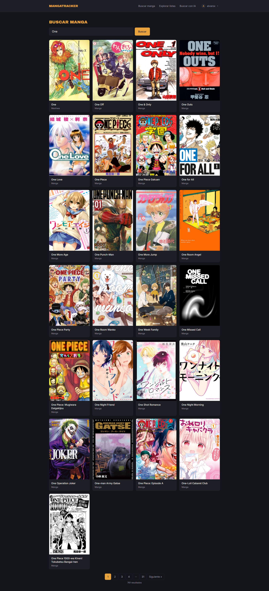
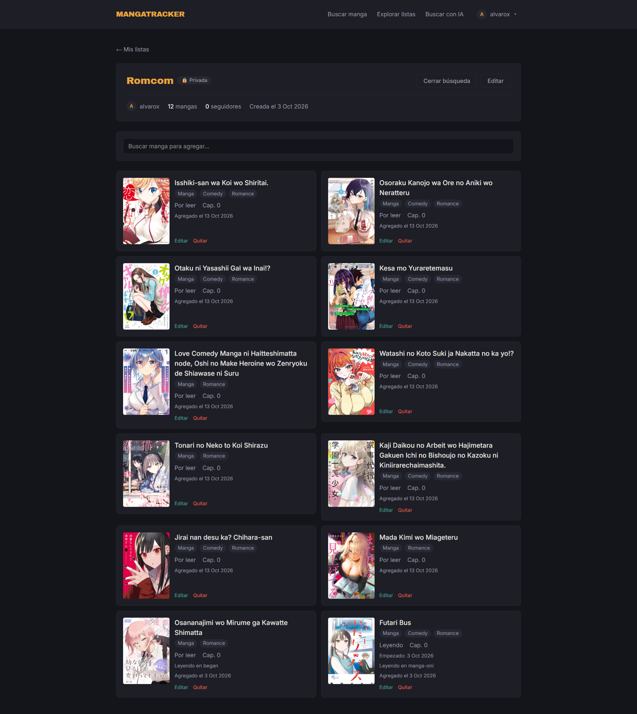

# 📚 MangaTracker

> Tracker de manga, manhwa y manhua con listas personalizables, listas públicas que se pueden seguir y búsqueda con IA. Tu progreso de lectura sobrevive aunque el sitio donde leés desaparezca.


**🔗 Demo:** [mangatracker.vercel.app](https://manga-tracker-pink.vercel.app/search) &nbsp;·&nbsp; **📖 API docs:** disponibles en local (Scalar, `/scalar/v1`)

> ⏱️ La API corre en el plan gratuito de Render: si nadie la usó hace un rato, la primera carga puede tardar entre 30 y 60 segundos.

<!-- Reemplazá estas rutas por capturas reales de tu app -->
<p align="center">
  
  
</p>

## 📑 Contenido

- [Por qué existe](#-por-qué-existe)
- [Funcionalidades](#-funcionalidades)
- [Stack](#-stack)
- [Arquitectura](#️-arquitectura)
- [Decisiones técnicas](#-decisiones-técnicas-destacadas)
- [Seguridad](#-seguridad)
- [Cómo correrlo](#-cómo-correrlo-localmente)
- [API](#️-api-en-resumen)
- [Limitaciones](#-limitaciones-conocidas-y-próximos-pasos)
- [Licencia](#-licencia)


## 💡 Por qué existe

Mucha gente lee manga en sitios no oficiales que cierran sin aviso, y con ellos se van las listas y el progreso de años. MangaTracker guarda una copia mínima e independiente de cada serie (título, portada, tipo) junto con el progreso de cada usuario, de modo que nada depende de que el sitio de origen, ni siquiera la fuente del catálogo, siga existiendo.

## ✨ Funcionalidades

| | |
|---|---|
| 🔐 **Cuentas propias** | Registro, login y sesión persistente con JWT y refresh tokens rotativos |
| 🔎 **Búsqueda** | Catálogo de manga con paginación real; la página vive en la URL |
| 📖 **Progreso** | Estado, capítulo (admite decimales como 145.5), puntaje, notas y fechas por manga |
| 🗂️ **Listas** | Públicas o privadas; un manga puede estar en varias listas sin duplicar su progreso |
| 👥 **Social** | Explorar listas públicas, seguirlas y ver el perfil de otros usuarios |
| 🤖 **Búsqueda con IA** | Describí lo que buscás con tus palabras y se traduce a filtros reales |
| 💾 **Backup** | Exportá a JSON (completo) o al XML de MyAnimeList, compatible con AniList; importá tu JSON |
| 📱 **Responsive** | Navbar adaptable, skeletons de carga, estados vacíos y manejo de errores consistente |

## 🧰 Stack

**Backend:** .NET 9 · ASP.NET Core · EF Core · ASP.NET Core Identity · FluentValidation · Mapperly · Polly · OpenAPI + Scalar
**Frontend:** Angular 21 (standalone, zoneless, signals) · Tailwind CSS v4 · Reactive Forms · RxJS
**Datos:** PostgreSQL (Neon)
**Servicios externos:** [Tenrai](https://github.com/Kareadita/tenrai.net) (catálogo) · Cloudinary (portadas) · Google Gemini (IA)
**Deploy:** Render (API en Docker) · Vercel (frontend) · Neon (base de datos)

## 🏗️ Arquitectura

El backend sigue una Clean Architecture simplificada. Las dependencias van en un solo sentido:

```
Api  →  Infrastructure  →  Application  →  Domain
```

```
MangaTracker/
├── src/
│   ├── MangaTracker.Domain/          # Entidades y enums, sin dependencias externas
│   ├── MangaTracker.Application/     # Interfaces, DTOs, validadores, excepciones de negocio
│   ├── MangaTracker.Infrastructure/  # EF Core, Identity, clientes de servicios externos
│   └── MangaTracker.Api/             # Controllers, filtros, configuración, Dockerfile
├── tests/
│   ├── MangaTracker.UnitTests/
│   └── MangaTracker.IntegrationTests/
└── frontend/                         # Angular 21
    └── src/app/
        ├── core/                     # Auth, servicios, interceptores, modelos
        ├── features/                 # Una carpeta por pantalla
        ├── layout/                   # Navbar y menú de usuario
        └── shared/                   # Componentes, directivas y utilidades reutilizables
```

Cada servicio externo está detrás de una interfaz agnóstica al proveedor (`IMangaCatalogService`, `IImageStorageService`, `IAiSearchTranslationService`, `IEmailService`). Cuando la API pública de Jikan anunció su cierre, migrar a Tenrai implicó tocar únicamente la capa de Infrastructure.

### Modelo de datos

```
ApplicationUser ──< UserMangaEntry >── MangaSnapshot >──< Genre
       │                  │
       │                  └──< MangaListItem >── MangaList
       │                                             │
       └─────────────────────────────────────────────┴──< ListFollow
```

- **`MangaSnapshot`**: copia mínima e independiente del catálogo, compartida entre todos los usuarios.
- **`UserMangaEntry`**: el progreso de un usuario sobre un manga, único por usuario y manga.
- **`MangaList` / `MangaListItem`**: agrupaciones opcionales sobre esas entradas; no guardan progreso propio.

## 🧠 Decisiones técnicas destacadas

- **Progreso único, listas como carpetas.** Actualizar el capítulo se refleja en todas las listas donde aparece el manga, sin copias desincronizadas.
- **Snapshots con control de concurrencia.** Si dos usuarios agregan la misma serie al mismo tiempo, un índice único frena el duplicado y el servicio recupera el snapshot ganador.
- **Refresh tokens rotativos con detección de reuso.** Cada refresh invalida el token anterior; si se reutiliza uno ya consumido, se revocan las sesiones del usuario. Los tokens se guardan hasheados. En el frontend, el interceptor comparte un único refresh en curso entre requests concurrentes (`shareReplay`), lo que evitó falsos positivos de la detección de reuso.
- **Resiliencia ante servicios externos.** Reintentos y circuit breaker con Polly, rate limiter hacia el catálogo y caché en memoria de las búsquedas.
- **IA con salida estructurada.** El modelo debe responder un JSON con un esquema fijo (tipo, estado y géneros tomados de una lista cerrada), que se envía como filtros reales al catálogo. Si no hay resultados, el servidor relaja los filtros progresivamente y se lo informa al usuario.
- **Backups autosuficientes.** El JSON incluye título, portada y tipo de cada manga, así que se puede restaurar sin consultar ningún servicio externo. El import reutiliza los servicios de negocio, respetando sus reglas.
- **Frontend moderno.** Angular zoneless con signals, `rxResource` para datos dependientes de parámetros reactivos y paginación dirigida por la URL.

## 🔒 Seguridad

- Contraseñas hasheadas con Identity, política compartida entre backend y validadores, lockout por intentos fallidos.
- Autorización por propiedad: las consultas filtran por dueño y un recurso ajeno responde igual que uno inexistente.
- Rate limiting por IP en autenticación y en la búsqueda con IA.
- CORS restringido a orígenes configurados; manejo global de excepciones que no filtra detalles internos.
- Documentación de la API solo expuesta en desarrollo; secretos fuera del repositorio.

## 🚀 Cómo correrlo localmente

### Requisitos

- .NET 9 SDK
- Node.js y pnpm
- Una base PostgreSQL (por ejemplo, una gratuita en [Neon](https://neon.tech))
- Cuentas gratuitas en Cloudinary, Google AI Studio y Brevo

### Variables de configuración

En local se cargan con `dotnet user-secrets`; en producción, como variables de entorno (con `__` en lugar de `:`).

| Clave | Descripción |
|---|---|
| `ConnectionStrings:DefaultConnection` | Cadena de conexión a PostgreSQL |
| `Jwt:Secret` | Cadena aleatoria de 32+ caracteres |
| `Jwt:Issuer` / `Jwt:Audience` | Por ejemplo, `MangaTracker` |
| `Jwt:AccessTokenExpirationMinutes` / `Jwt:RefreshTokenExpirationDays` | Por ejemplo, `15` y `14` |
| `Tenrai:BaseUrl` | URL base de la API de Tenrai |
| `Cloudinary:CloudName` / `ApiKey` / `ApiSecret` | Credenciales de Cloudinary |
| `Gemini:ApiKey` / `Gemini:Model` | Clave de Google AI Studio y modelo a usar |
| `Frontend:Url` / `Frontend:AllowedOrigins` | URL del frontend y orígenes permitidos por CORS |

### Backend

```bash
cd src/MangaTracker.Api
dotnet user-secrets init
dotnet user-secrets set "ConnectionStrings:DefaultConnection" "<tu-cadena>"
# ...resto de las claves de la tabla anterior

dotnet ef database update --project ../MangaTracker.Infrastructure
dotnet run
```

La documentación interactiva queda en `https://localhost:7072/scalar/v1` (solo en desarrollo).

### Frontend

```bash
cd frontend
pnpm install
pnpm start
```

El servidor de desarrollo usa `proxy.conf.json` para reenviar `/api` al backend; ajustá el puerto si el tuyo es distinto.


## 🗺️ API en resumen

| Área | Endpoints principales |
|---|---|
| **Auth** | `POST /api/auth/register` · `login` · `refresh` · `logout` · `GET /api/auth/me` |
| **Catálogo** | `GET /api/manga/search` · `GET /api/manga/{malId}` · `POST /api/manga/ai-search` |
| **Progreso** | `/api/manga-list` (alta, listado con filtro por estado, edición y baja) · `GET /api/manga-list/by-manga/{malId}` |
| **Listas** | `/api/lists` (CRUD) · `GET /api/lists/{id}` (detalle paginado) · `POST /api/lists/{id}/items/by-manga` |
| **Social** | `GET /api/lists/public` · `GET /api/users/{id}` · `GET /api/users/{id}/lists` · `POST` y `DELETE /api/lists/{id}/follow` · `GET /api/lists/followed` |
| **Backup** | `GET /api/backup/export/json` · `GET /api/backup/export/mal-xml` · `POST /api/backup/import/json` |

## 📝 Limitaciones conocidas y próximos pasos

- [ ] Recuperación de contraseña y confirmación de email
- [ ] Tests 
- [ ] Búsqueda semántica con embeddings para identificar títulos obscuros a partir de una descripción vaga
- [ ] Cold start de 30-60 s por el plan gratuito de Render

## 📄 Licencia
© 2026 Alvaro Díaz · All Rights Reserved

Proyecto personal con fines de portfolio. El código está disponible para lectura y referencia, pero no se permite su uso, modificación ni redistribución sin autorización expresa del autor.

## 🙏 Créditos

- Catálogo provisto por [Tenrai](https://github.com/Kareadita/tenrai.net) (Jikan API alternative)
- Portadas almacenadas en [Cloudinary](https://cloudinary.com)
- Búsqueda con IA impulsada por [Google Gemini](https://ai.google.dev)

---

<sub>Hecho por **Alvaro Diaz** · [LinkedIn](https://www.linkedin.com/in/alvaro-diaz-61145a29a/) · [GitHub](https://github.com/alvaroad29)</sub>